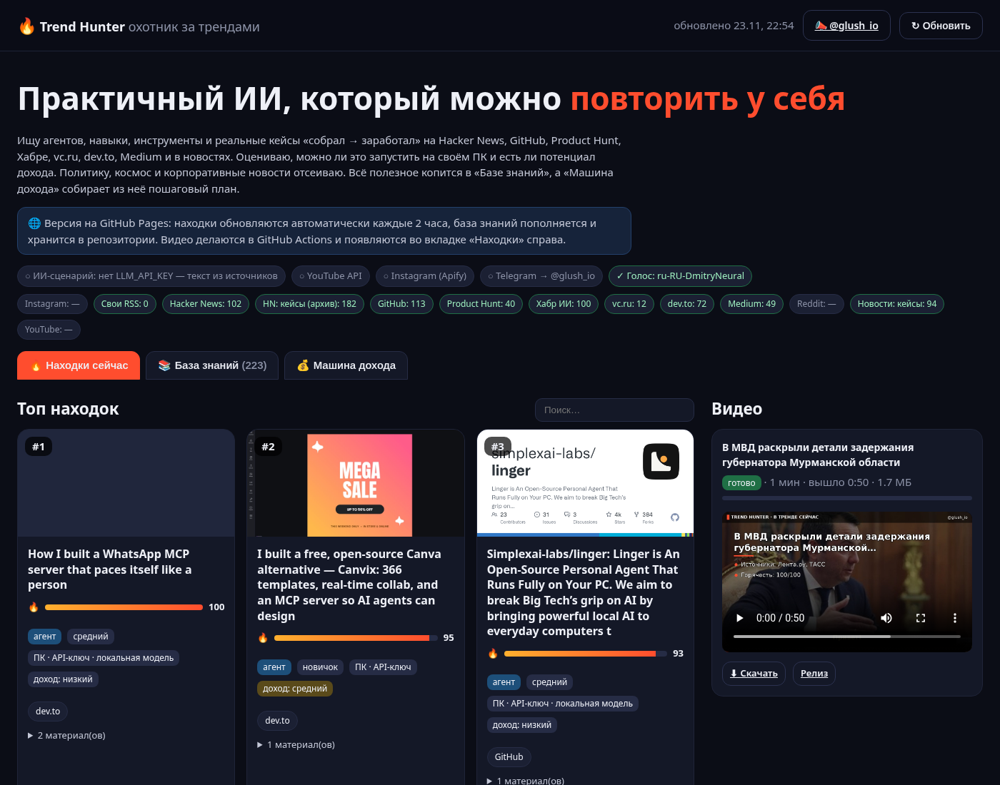

# 🔥 Trend Hunter — практичный ИИ и «машина дохода»

**Находит ИИ-агентов, навыки, инструменты и реальные кейсы «собрал → заработал», которые можно повторить на своём ПК. Копит их в базу знаний, собирает из них пошаговый план своего продукта с постоянным доходом и делает видео «как повторить» с мужской озвучкой для Telegram-канала.**

🌐 **Сайт:** https://avtomaster24bot-lab.github.io/trend-hunter/ · 📣 **Канал:** [@glush_io](https://t.me/glush_io)



## Что внутри

| Раздел | Что делает |
|---|---|
| 🔥 **Находки сейчас** | Свежие практичные находки: Show HN и обсуждения на Hacker News, новые репозитории GitHub (агенты, MCP-серверы, навыки, автоматизация, локальные модели — с ростом звёзд), Product Hunt, Хабр (ИИ, ML, ИИ-агенты, n8n), vc.ru, dev.to, Medium, Google News по запросам «AI agent made money», «ИИ агент заработок», «n8n автоматизация», «локальная нейросеть на ПК»…, YouTube (с ключом), Reddit (если доступен) |
| 🧮 **Оценка** | Каждая находка получает балл «можно применить у себя + потенциал дохода»: плюс за агентов, кейсы с доходом, открытый код, гайды, локальные модели, автоматизацию; минус за политику, космос, корпоративные сделки, акции, регулирование и «чистую науку». С LLM-ключом — дополнительная ИИ-разметка и русские описания |
| 🏷 **Теги** | Тип (кейс с доходом / агент / навык / инструмент / гайд), сложность, что нужно (ПК / GPU / API-ключ / локальная модель), потенциал дохода (оценка, не обещание) |
| 📚 **База знаний** | Всё полезное копится между запусками в `knowledge/knowledge.json` (в репозитории, без дублей), включая старые, но ценные истории из архива Hacker News. Поиск, фильтры и «как применить на своём ПК» по шагам |
| 💰 **Машина дохода** | План из 7 этапов (фундамент на ПК → ниша → свой агент → автоматизация контента → монетизация → аналитика → масштаб) с галочками (хранятся в браузере) и ссылками на материалы из базы. Trend Hunter — уже этап 3: контент-канал с автоматическими видео |
| 🎬 **Видео** | Ролик про лучшую находку по схеме: что это → кто сделал и какой результат (только из источника) → как повторить по шагам → что понадобится. Мужской голос |

### Проверенный кейс: Larry

История, с которой всё началось, проверена по первоисточникам и лежит в базе знаний с пометкой ★: **Larry** — агент на OpenClaw, которого **Oliver Henry** (разработчик, сотрудник RevenueCat — не студент) запустил на старом игровом ПК. Larry делает TikTok-слайдшоу для двух его iOS-приложений. По словам автора: 500 000 просмотров меньше чем за неделю и ≈ $588 MRR, позже ≈ $714 MRR. Источники: [Shipping Skool](https://www.shippingskool.com/use-cases/oliver-henry-openclaw-agent-larry-tiktok-slideshows), [Luminary Lane](https://www.luminarylane.app/blog/from-larry-to-lane/), [навык LarrySkill](https://github.com/OllieWazza/LarrySkill). Громкие «$4000 за неделю» — в основном мем-монета от фанатов, это не повторяемая часть.

## Всё по-русски, с репозиториями и инструкцией сборки

- **Перевод без платных ключей.** Заголовки и описания находок и базы знаний переводятся на русский бесплатным веб-переводчиком Google (пакетами, с повторами; запасной — MyMemory). Кеш — `knowledge/translations_cache.json`, его обновляет и коммитит workflow, поэтому одно и то же не переводится повторно. С `LLM_API_KEY` описания и шаги пишет LLM.
- **Репозитории.** Ссылка на GitHub берётся из самой находки или из текста статьи (dev.to, Хабр, HN, Medium…). По GitHub API и README определяются стек (Python / Node.js / Docker / Rust / Go…), ключи из `.env`, и настоящие команды установки и запуска. На карточке — кнопки «GitHub ↗» и «Источник ↗», в окне «🛠 Как собрать» — пошаговая инструкция с кнопками «Копировать». Кеш — `knowledge/repos_cache.json` (обновляется раз в неделю).
- **Картинки.** og:image статьи или карточка репозитория `opengraph.githubassets.com`; если картинки нет или она не загрузилась — фирменная обложка с типом находки, пустых блоков не бывает.
- Модуль: `app/enrich.py`.

## Сайт на GitHub Pages (уже работает)

Адрес: **https://avtomaster24bot-lab.github.io/trend-hunter/**

GitHub Pages — это статический хостинг: там нельзя запускать Python и ffmpeg. Поэтому сайт работает так:

| Что | Как |
|---|---|
| **Находки и база знаний** | Workflow `.github/workflows/pages.yml` каждые 2 часа (и при изменении кода) собирает находки, оценивает их, пополняет `knowledge/knowledge.json` (коммитит в репозиторий) и публикует сайт |
| **Кнопка «Сделать видео»** | Показывает ползунок с рекомендованной длительностью и открывает страницу запуска **GitHub Actions → «Сделать видео»**. Там нажмите **Run workflow**, вставьте тему (`topic`) и длительность (`minutes`) — подсказка и кнопки «Копировать» есть прямо в окне сайта |
| **Генерация** | Workflow `.github/workflows/generate-video.yml` делает ролик (сбор материала → сценарий → мужская озвучка → видео) |
| **Хранение видео** | Каждый ролик — отдельный **GitHub Release** (`video-…`) с файлом MP4 и обложкой. В git-историю видео не попадают, репозиторий не раздувается |
| **Список видео на сайте** | После генерации сайт пересобирается и показывает плеер со всеми роликами из релизов |
| **Telegram** | Только если добавлен секрет `TELEGRAM_BOT_TOKEN` (и галочка `publish`). По расписанию каждые 6 часов — автопостинг самого горячего нового тренда; без токена расписание просто пропускается |

Запускать генерацию может только владелец репозитория (или те, кому вы дали доступ) — посетители сайта видят тренды и готовые видео, но ничего не запускают.

Нужен сайт с кнопкой «сделать и опубликовать» в один клик — разверните Docker-версию (см. «Деплой сайта»).

## Быстрый старт (локально)

Нужны Python 3.11+ и ffmpeg.

```bash
git clone https://github.com/avtomaster24bot-lab/trend-hunter.git
cd trend-hunter
python3 -m venv .venv && . .venv/bin/activate
pip install -r requirements.txt
cp .env.example .env        # и впишите ключи (см. ниже)
uvicorn app.main:app --port 8000
```

Откройте http://localhost:8000 — увидите топ тем. Нажмите **«🎬 Сделать видео»**, выберите длительность и (если подключён бот) поставьте галочку «Сразу опубликовать».

Командная строка:

```bash
python -m app.cli trends                       # топ трендов в консоли
python -m app.cli sample --minutes 1 --out a.mp4   # тестовый ролик без всяких ключей
python -m app.cli auto --publish               # самый горячий новый тренд → видео → канал
python -m app.cli auto --minutes 5 --publish   # то же, фиксированно 5 минут
```

## Какие ключи нужны

**Без ключей работает:** сбор находок с Hacker News, GitHub, Product Hunt, Хабра, vc.ru, dev.to, Medium и Google News; оценка и теги; база знаний и «Машина дохода»; мужская озвучка (Edge / офлайн Piper) и сборка видео. Сценарий в этом режиме собирается из русских текстов и шагов «как повторить» — коротко. Общие новостные источники (Google Тренды, Лента, ТАСС) по-прежнему доступны через `SOURCES`, но по умолчанию выключены.

| Переменная | Зачем | Где взять |
|---|---|---|
| `TELEGRAM_BOT_TOKEN` | публикация в канал | [@BotFather](https://t.me/BotFather) → `/newbot` |
| `TELEGRAM_CHANNEL` | канал, по умолчанию `@glush_io` | можно `@имя`, `https://t.me/имя` или `-100…` |
| `LLM_API_KEY` (+ `LLM_BASE_URL`, `LLM_MODEL`) | полноценный ИИ-сценарий нужной длины | [OpenAI](https://platform.openai.com/api-keys), [xAI](https://console.x.ai), DeepSeek, OpenRouter |
| `YOUTUBE_API_KEY` | тренды YouTube и поиск видео по теме | [Google Cloud Console](https://console.cloud.google.com/apis/library/youtube.googleapis.com) → включить YouTube Data API v3 → Credentials → API key (бесплатно, 10 000 единиц/день) |
| `APIFY_TOKEN` | Instagram (необязательно, платно) | [Apify](https://console.apify.com/account/integrations) |
| `OPENAI_API_KEY` / `ELEVENLABS_API_KEY` | другой мужской голос (необязательно) | OpenAI / ElevenLabs |
| `ADMIN_PASSWORD` | чтобы чужие не запускали генерацию на вашем сервере | придумайте сами |

### Как подключить Telegram-канал

1. Создайте бота в [@BotFather](https://t.me/BotFather), скопируйте токен в `TELEGRAM_BOT_TOKEN`.
2. Откройте канал [@glush_io](https://t.me/glush_io) → «Администраторы» → «Добавить администратора» → найдите бота → право **«Публикация сообщений»**.
3. Проверка: откройте `http://localhost:8000/api/telegram/check` — должно быть `"ok": true` и название канала.

## Автопостинг через GitHub Actions

Файл `.github/workflows/generate-video.yml` запускается каждые 6 часов (и вручную во вкладке **Actions → «Сделать видео» → Run workflow**, там же можно указать тему, длительность и голос).

1. Репозиторий → **Settings → Secrets and variables → Actions → New repository secret**:
   `TELEGRAM_BOT_TOKEN` (обязательно), `LLM_API_KEY`, `YOUTUBE_API_KEY`, по желанию `APIFY_TOKEN`, `OPENAI_API_KEY`, `ELEVENLABS_API_KEY`.
2. Вкладка **Variables** (по желанию): `TELEGRAM_CHANNEL`, `LLM_BASE_URL`, `LLM_MODEL`, `TREND_REGION`, `TTS_PROVIDER`.
3. По расписанию длительность = рекомендованная, но не больше 10 мин (`--max-minutes 10`). Уже опубликованные темы запоминаются и не повторяются.
4. Каждое видео сохраняется в **Releases** и появляется на сайте.

Пока секрета `TELEGRAM_BOT_TOKEN` нет — запуск по расписанию просто пропускается.

## Деплой сайта

**Docker** (любой VPS, Render, Railway, Fly.io):

```bash
docker build -t trend-hunter .
docker run -d -p 8000:8000 --env-file .env -v $(pwd)/data:/data trend-hunter
```

Нужен именно сервер с Python и ffmpeg (видео рендерится на сервере) — GitHub Pages / Vercel для этого не подходят. Для роликов 10–30 минут лучше 2+ CPU и 2 ГБ RAM. На бесплатных тарифах с «засыпанием» долгие ролики могут прерываться — тогда используйте GitHub Actions.

## Устройство

```
app/
  collectors/ai.py  практичные источники: HN, GitHub, Product Hunt, Хабр, vc.ru, dev.to, Medium, новости-кейсы, Reddit, YouTube
  practical.py  оценка «применимо на своём ПК + деньги», теги, шаги «как применить»
  knowledge.py  база знаний (накопление, дубли, LLM-разметка) и «Машина дохода»
  seeds.py      проверенные вручную материалы (Larry, OpenClaw, Ollama, n8n, Postiz…)
  collectors/   rss.py и social.py — общие источники (выключены по умолчанию), Instagram через Apify
  trends.py     склейка в темы, «горячесть», рекомендованная длительность
  research.py   материал по теме: статьи, Википедия, новости, YouTube, картинки
  script.py     сценарий: LLM или из текстов
  tts.py        мужской голос: edge / openai / elevenlabs
  video.py      слайды + субтитры + ffmpeg, ужатие под лимит Telegram
  telegram.py   sendVideo в канал
  pipeline.py   задания (очередь, статус, журнал)
  main.py       FastAPI + веб-интерфейс (app/static)
  cli.py        командная строка и автопилот
  static_build.py  статическая версия сайта для GitHub Pages
```

## Честные ограничения

- Перевод машинный: встречаются неточности в терминах (например, Shipyard → «верфь»). Оригинальный заголовок показан под русским.
- Команды сборки берутся из README автора; если там их нет — подставляется стандартная сборка для стека (помечено на карточке).

- Оценка «применимо/доход» — эвристика по ключевым словам. Без LLM-ключа бывают промахи (кейсом может посчитаться статья с цифрами), а англоязычные материалы остаются с английским описанием. С `LLM_API_KEY` описания и шаги пишутся по-русски, мусор отсеивается точнее.
- «Потенциал дохода» — оценка типа находки, а не обещание. Цифры в кейсах — только как их сообщают авторы; проверяйте первоисточник.
- Среди новых репозиториев GitHub встречаются проекты с накрученными звёздами — часть отсеивается, но перед запуском чужого кода смотрите автора, лицензию и код (особенно навыки, которые просят API-ключи).
- Без LLM-ключа ролик по англоязычной находке получается коротким: читаются только русские тексты и шаги «как повторить».

- **Instagram** не даёт публичного API трендов. Подключается только через сторонний сервис (Apify, платно), иначе источник пропускается.
- **Reddit** часто блокирует запросы с серверов дата-центров (HTTP 403) — тогда источник пропускается, остальные работают.
- **YouTube** тренды доступны только с бесплатным API-ключом. Содержимое самих видео (речь) не расшифровывается — берутся заголовки и описания.
- Некоторые сайты защищены от роботов — тогда берётся анонс из RSS вместо полного текста.
- **Без LLM-ключа** длинный ролик может выйти короче выбранной длительности: текста из источников просто не хватает. С ключом ИИ пишет сценарий нужного объёма.
- **Telegram Bot API** принимает видео до **50 МБ**. Сайт сам пережимает ролик, а 20–30 минут обычно и так укладываются (статичные слайды весят мало). Если не влезает — режет на части. Чтобы отправлять до 2 ГБ одним файлом, поднимите [локальный Bot API сервер](https://github.com/tdlib/telegram-bot-api) и укажите `TELEGRAM_API_URL` и `TELEGRAM_MAX_MB=2000`.
- Бесплатный голос Edge — неофициальный сервис Microsoft: иногда отвечает пусто. Стоят повторы, а если не помогло — весь ролик переозвучивается офлайн-голосом Piper (звучит чуть более «роботно»). Для стабильного качества — OpenAI (`onyx`) или ElevenLabs.
- Видео — это слайды с фото и текстом, а не монтаж чужих роликов (так нет проблем с авторскими правами на видеоряд). Фото берутся из статей-источников — для коммерческого канала проверяйте права.
- **GitHub Pages** не умеет запускать задачи: кнопка на сайте ведёт в GitHub Actions, где запуск делается в 2 клика (тему и длительность нужно вставить вручную — GitHub не даёт заполнить поля ссылкой). Видео появляется через 5–15 минут.
- GitHub отключает расписания в репозиториях без активности 60 дней — тогда зайдите в Actions и включите workflow снова.
- Факты ИИ берёт только из собранных материалов, но перед публикацией важных тем лучше просмотреть ролик.
